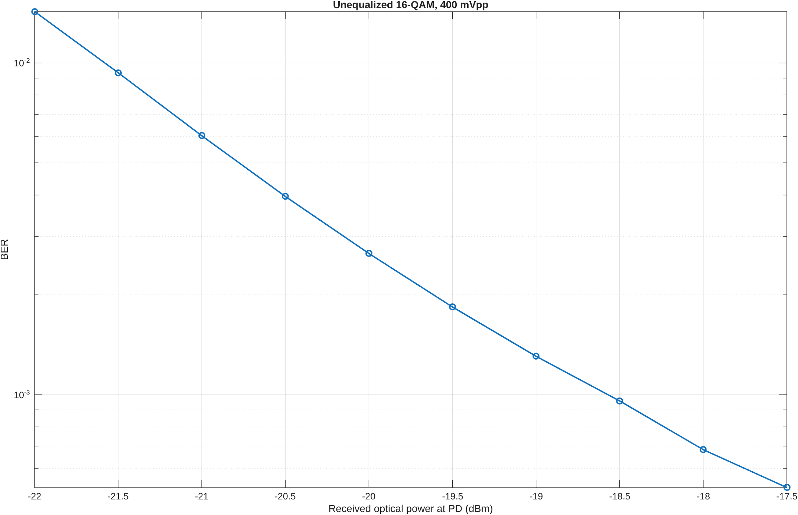

# Unequalized BER versus received optical power

Simulation-only curve for the fixed 16-QAM, 400 mVpp A-RoF link. The saved counts are reused from the previously completed five-seed sweep in `../received_power/seed_metrics.csv`; this cleanup does not claim a new full sweep or additional experimental validation. There are 1,310,720 bits per power.

The effective gain and noise PSD in `../../link_configuration.m` remain fixed. The earlier calibration was conditional and a partial quantitative match; its provenance remains in `../received_power/`. No paper points, fitting or comparison scores enter the current runner.

Run `matlab/main.m`, or call `ber_vs_rop(link_configuration())` after adding `matlab` to the MATLAB path. New runs save their configuration, per-seed counts, pooled metrics and plots under `datasets/physical_link/ber_vs_rop/`. The stages-only runner was checked against the archived physics at three powers and replayed one full-size saved case exactly.
