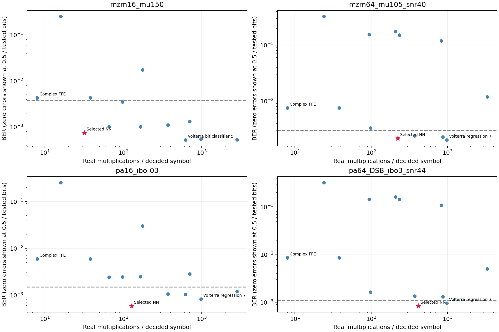
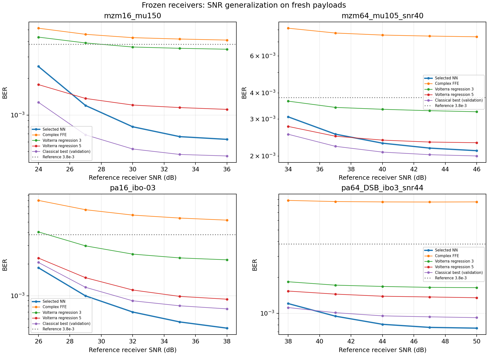

# Four locked 60 GHz equalizer cases

All links use 1 Gbaud single-carrier Gray QAM, RRC rolloff 0.25, 8 waveform samples/symbol and the same 2 complex equalizer samples. Training/validation/test payloads are independent. Confirmation uses 3 seeds and 50,000 test symbols per seed. Networks predict Gray bits; EVM is explicitly hard-decision EVM.

| Case | QAM | MZM drive | PA IBO / AMPM | Echo | DSB fiber | Reference SNR |
|---|---:|---:|---|---|---|---:|
| [1](case1_mzm16/README.md) | 16 | 1.5 | — | — | — | 30 dB |
| [2](case2_mzm64_memory/README.md) | 64 | 1.05 | — | 0.2 ∠ 36°; 1 symbol | — | 40 dB |
| [3](case3_rfpa16_memory/README.md) | 16 | — | -3 dB / 40° | 0.25 ∠ 45°; 1 symbol | — | 32 dB |
| [4](case4_rfpa64_dsb/README.md) | 64 | — | 3 dB / 40° | — | 0.3 km | 44 dB |

| Case | Real network dimensions | Activation | Parameters | Multiplications | Activation evaluations |
|---|---|---|---:|---:|---:|
| 1 | 4 → 4 → 4 | tanh | 40 | 32 | 4 |
| 2 | 4 → 16 → 6 | learned_multilevel | 188 | 224 | 48 |
| 3 | 4 → 16 → 4 | tanh | 148 | 128 | 16 |
| 4 | 4 → 16 → 16 → 6 | tanh | 454 | 416 | 32 |

The final layer contains Gray-bit logits. Per-case learning rate, optimizer, batch size, weight decay, epoch budget and validation-selected restart count are in neural_parameters.csv; actual fitted run details are in fitted_neural_parameters.csv.

| Case | NN BER | FFE BER | Best classical BER within NN multiplication budget | Classical/NN cost at locked target | Target criterion |
|---|---:|---:|---|---:|---|
| 1 | 0.000748 | 0.0043 | Volterra regression 1: 0.00428 | 2.06× | Pass |
| 2 | 0.00215 | 0.00754 | Volterra regression 3: 0.0033 | 1.66× | Pass |
| 3 | 0.000587 | 0.00595 | Volterra bit classifier 2: 0.00244 | 2.90× | Pass |
| 4 | 0.000841 | 0.0086 | Volterra regression 5: 0.00135 | 2.36× | Pass |

All tested classical receivers, including higher-cost matches, are retained in comparison.csv; baseline_parameters.csv reports ridge/bandwidth and optimizer convergence. These are explicit multiplication savings with separately reported activation costs, not measured hardware speed or power. The criterion is descriptive for this bounded catalog and locked validation-selected BER targets; it is not a claim that conventional methods can never solve these channels.

Targets and architectures were locked before generating the confirmation data. protocol_history.md records the validation-only search extensions. Hard-decision EVM and raw counts are in the CSVs. Activation comparisons in discovery_models.csv are validation ablations, not demonstrated mathematical novelty or independent test confirmation of an activation contribution.
