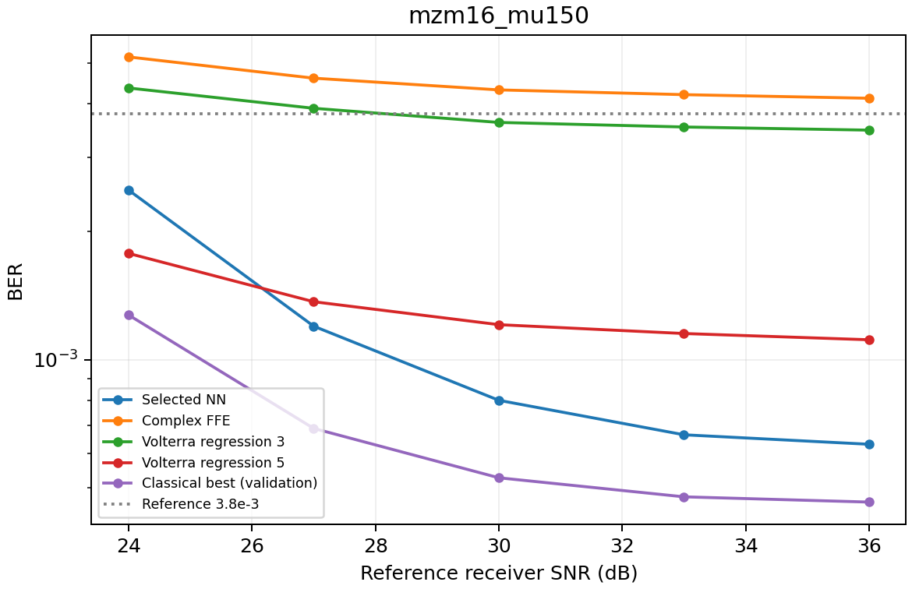

# Case 1: MZM16

Condition: 16-QAM; MZM drive 1.5; PA —; echo —; DSB fiber —; reference SNR 30 dB.

| Network | Activation | Parameters | Real multiplications | Activation evaluations |
|---|---|---:|---:|---:|
| 4 → 4 → 4 | tanh | 40 | 32 | 4 |

Gray-bit BCE training uses adamw then LBFGS, learning rate 0.003, weight decay 0.0001, minibatches of 512, up to 600 epochs and LBFGS polishing. 3 restarts are selected by validation BCE. See neural_parameters.csv and fitted_neural_parameters.csv for configuration and actual fitted run details.

Pooled NN BER: **0.000748348**; FFE: 0.00430175; best tested classical receiver within the NN multiplication budget: **Volterra regression 1**, BER 0.00428175. Locked BER target: 0.0038 (reference grid). Target/cost criterion: **met**; cheapest tested classical receiver meeting it costs 2.06× the NN's explicit real multiplications.

Curves use frozen receivers on fresh payloads, not per-point retraining. Higher-cost classical receivers remain in comparison.csv. Nominal Wilson intervals assume independent bits; confirmation_metrics.csv also gives paired contiguous-symbol-block uncertainty and seed results. Counts exclude additions and fusible normalization; activation evaluations are separate, so multiplication savings do not establish lower latency or power. Classical inference is float64, neural inference float32. These results concern the tested receiver catalog and observation window, not universal necessity of neural processing or experimental reproduction of the papers. Activation ablations are in discovery_models.csv and do not establish novelty or a test-confirmed activation contribution.
