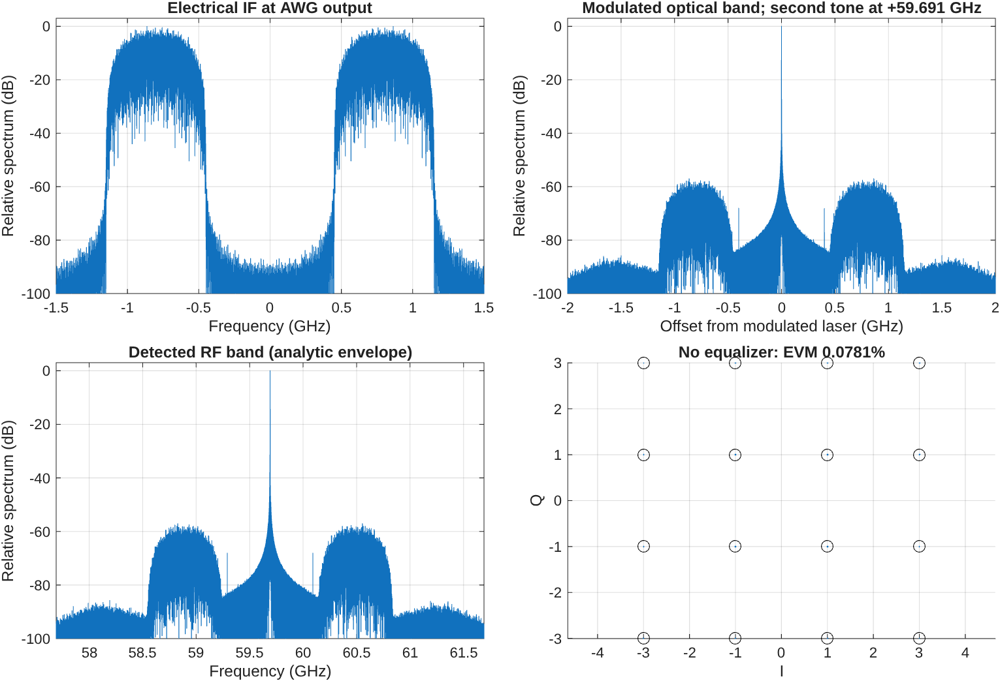
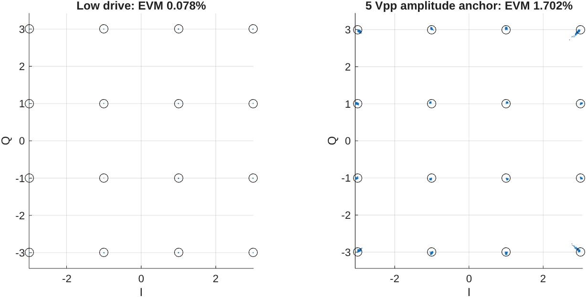

# Physical baseline review

Single 0.4 Gbaud, 16-QAM optical-beating link; no equalizer.

Calculated optical separation: 59.691050 GHz. Low-drive EVM: 0.078116%; errors: 0/16384 bits.
Actual MZM drive: 0.099187 V RMS, 0.531770 Vpp. Prefix-only timing offset: 0.362500 internal samples.

All 10 physical/numerical checks pass. Doubling the internal sample rate changes the normalized recovered payload by 1.33694e-05 RMS; increasing the FFT period/padding changes it by 1.95499e-12.

The 5 Vpp run matches only the approximate drive amplitude mentioned in the paper: EVM 1.701671%, errors 0/16384. It is not a reproduction of measured noise or sensitivity.

Optical fields have normalized power. RF envelope detection uses an ideal amplitude law, not a measured detector response. EDFA gain is ideal/noiseless; receiver noise, laser noise, driver compression and PD saturation are not calibrated or simulated. Bandwidth responses and SMF constants are explicit approximations. Zero observed errors in this noiseless diagnostic do not establish a practical zero BER.

See [PHYSICAL_LINK.md](PHYSICAL_LINK.md) for assumptions. Review this baseline before dataset export or FFE/Volterra/NN comparisons.

