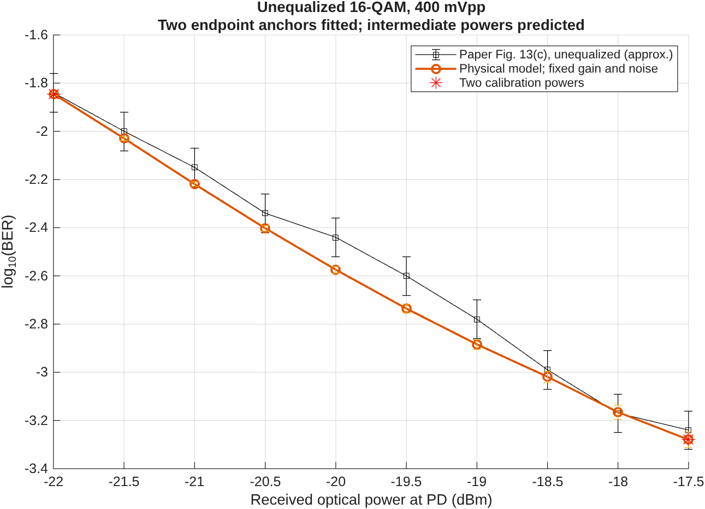

# BER versus received optical power

Paper Figure 13(c): unequalized 16-QAM at 400 mVpp, 0.4 Gbaud, 15 km fiber and 1 m millimeter-wave wireless link. No equalizer or NN is used.

Only the two endpoints (-22 and -17.5 dBm) identify effective driver gain and constant aggregate post-detector IF-noise PSD. All eight intermediate powers are excluded from the numerical fit. This is a separate calibration from Figures 9/11; the earlier voltage-curve files and parameters are preserved.

Effective gain 17.097236; fixed noise PSD 1.9966087e-25 in effective detector-output units squared/Hz. Validation: 5 seeds, 65536 payload symbols per seed, 1310720 bits per power.

| ROP (dBm) | Approximate paper BER | Simulated BER | Errors / bits | Fitted power? |
|---:|---:|---:|---:|---|
| -22.0 | 0.014454 | 0.014288 | 18727 / 1310720 | 1 |
| -21.5 | 0.01 | 0.0093414 | 12244 / 1310720 | 0 |
| -21.0 | 0.0070795 | 0.0060349 | 7910 / 1310720 | 0 |
| -20.5 | 0.0045709 | 0.0039589 | 5189 / 1310720 | 0 |
| -20.0 | 0.0036308 | 0.0026642 | 3492 / 1310720 | 0 |
| -19.5 | 0.0025119 | 0.0018379 | 2409 / 1310720 | 0 |
| -19.0 | 0.0016596 | 0.0013054 | 1711 / 1310720 | 0 |
| -18.5 | 0.0010233 | 0.00095749 | 1255 / 1310720 | 0 |
| -18.0 | 0.00067608 | 0.00068283 | 895 / 1310720 | 0 |
| -17.5 | 0.00057544 | 0.0005249 | 688 / 1310720 | 1 |

5/8 intermediate powers fall within the declared +/-0.08 log10(BER) read-off allowance. This is a descriptive comparison, not an experimental confidence test.

Largest absolute log10(BER) difference: 0.1357 at -19.5 dBm. The remaining discrepancy prevents a full quantitative curve-replication claim.

This fit and the earlier Figures 9/11 fit are alternative effective parameterizations of the same topology. Different fitted gains must not be presented as one jointly validated device model. The ROP fit is the current candidate for physical-baseline review.

ROP is assumed to mean total time-average power in both optical tones incident on the PD. Both fields scale by the square root of the requested power ratio while their relative powers and modulation remain fixed. Optical beating therefore makes RF current proportional to optical watts. Effective responsivity is set to 1 A/W; unresolved RF gains and noise are absorbed into a lumped receiver-noise parameter. This does not independently reconstruct detector responsivity, laser powers, ASE, shot noise or receiver noise figure.

The constant post-detector noise hypothesis predicts noise-to-signal power proportional to optical power to the minus second power. It is tested here, not established by the paper. No extra per-power gain, noise, distortion or curve correction is applied.

Paper values are approximate manual readings, with +/-0.08 log10(BER) allowance and approximately +/-0.08 dB horizontal reading uncertainty. They are not author-supplied data or experimental confidence intervals. The -21 dBm marker is partly obscured by the legend. Simulation BER bars are nominal Wilson intervals assuming independent bits; temporal dependence and finite seed count limit that interpretation.

Calibration uses seed 8601 and a conditional Gaussian decision-cell surrogate. Frozen settings are then checked using full waveform simulation with real IF noise and independent validation seeds 8701-8705 in the study profile. Within each seed, waveform and noise draws are paired across power values. Prefix-only receiver timing/gain recovery is repeated at each power. Held-out here means excluded from parameter fitting, not blind experimental validation.

Run from the repository root: `addpath('matlab'); c=arof.configuration(); arof.match_received_power(c);`. To rerender the saved BER plot without rerunning simulation, call `arof.plot_received_power('matlab/results/received_power',c)`. PNG and vector PDF plus raw per-seed CSV counts are supplied. Calibration provenance is in frozen_calibration.json and calibration_search.csv.
