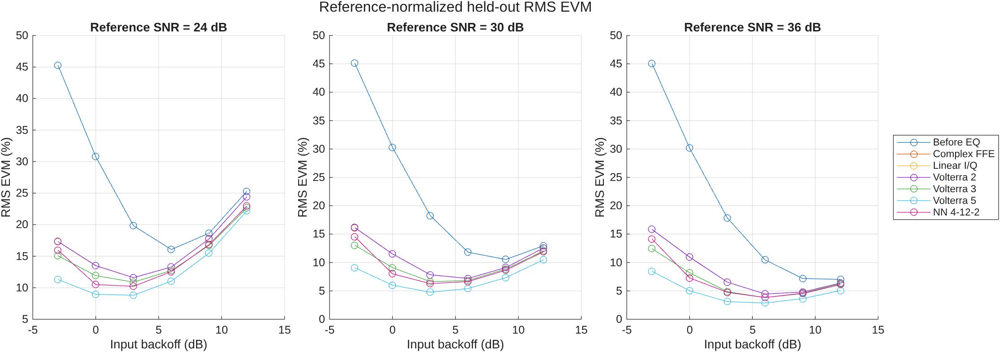
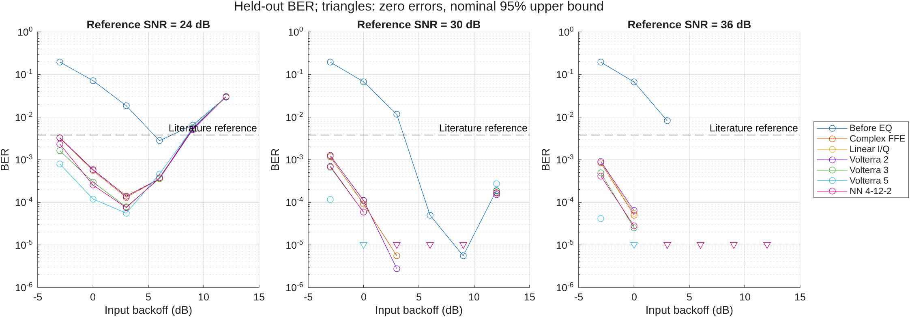
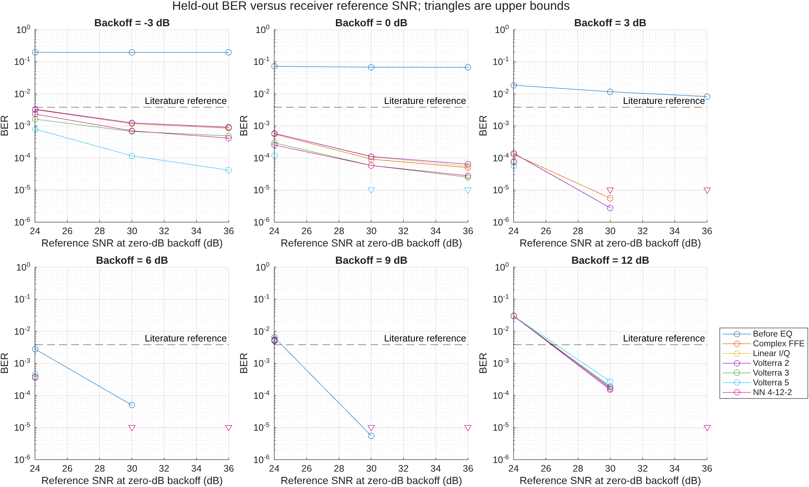
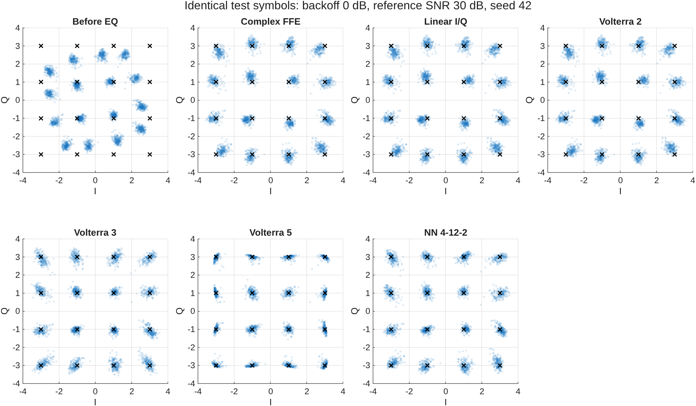
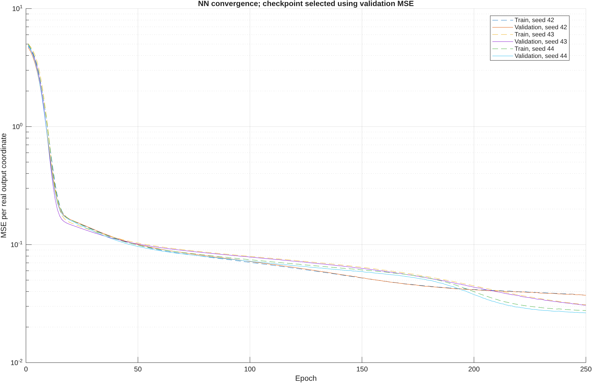
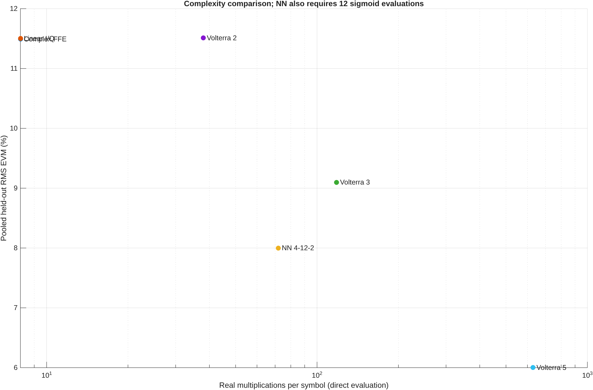

# Scenario 1: validated RF-driver benchmark

This report retains the first completed study's figures and numerical metrics
in Git. Full datasets, model checkpoints, source snapshots, vector PDFs and
MATLAB FIG files remain in the ignored local run directory:

`datasets/scenarios/pa_single_carrier/scenario1_validated_study/`

The experiment uses 60 GHz complex-envelope single-carrier 16-QAM at 1 Gbaud,
isolated Rapp AM/AM plus bounded AM/PM distortion, and fixed receiver noise.
See [the scenario guide](../../README.md) for equations, assumptions and commands.

## Outcome

The 60 runs cover three independent seeds, six backoffs and three reference
SNRs, plus two linear controls per seed. Each operating point pools **359,988
held-out bits**. All receivers have the same two-complex-symbol input window.

At 0 dB backoff and 30 dB reference SNR:

| Receiver | Pooled RMS EVM | Bit errors / 359,988 bits | BER |
|---|---:|---:|---:|
| Before EQ | 30.289% | 24,349 | 0.0676384 |
| Complex FFE | 11.492% | 33 | 9.167e-5 |
| Linear I/Q | 11.502% | 39 | 1.083e-4 |
| Volterra 2 | 11.510% | 40 | 1.111e-4 |
| Volterra 3 | 9.097% | 21 | 5.834e-5 |
| Volterra 5 | 6.001% | 0 | Nominal 95% upper bound: 1.025e-5 |
| NN 4-12-2 | 7.998% | 21 | 5.834e-5 |

The NN has lower pooled EVM than the complex FFE at all 18 PA operating
points. Fifth-order Volterra has lower pooled EVM than the NN at all 18.
FFE, Volterra 3, Volterra 5 and the NN each meet the `3.8e-3` reference at
16 of 18 points using the nominal binomial upper bound. At 24 dB reference
SNR and 9 or 12 dB backoff, none meets that reference because backoff reduces
effective SNR. No tested operating point establishes that only the NN works.

The fifth-order model has 252 fitted real coefficients and about 629 direct
evaluation multiplications per symbol. The NN has 86 parameters and 72 MAC
multiplications plus 12 sigmoids. These are different computational budgets.
The NN reaches the 250-epoch cap in **59 of 60 runs**; many validation curves
are still improving. These results compare the stated architecture/training
budget, not fully converged or optimally configured neural equalization in
general. Increasing the NN training budget is a distinct follow-up experiment;
test results were not used to tune these settings.

The linear noiseless control has 0.0558% received EVM, confirming the small
finite-RRC truncation floor. The linear 30 dB AWGN control has 3.1603% received
EVM, as expected. Eight versus sixteen samples per symbol also passes the
strong-drive numerical convergence check.

## Figures

Downward triangles indicate zero observed errors at the nominal 95% upper
confidence bound, not measured nonzero BER. Binomial bounds assume independent
errors and may be optimistic for correlated channel errors. The per-seed
metrics are retained for inspection.

## Validation and provenance

- Four MATLAB numerical tests passed; MATLAB Code Analyzer reported no
  diagnostics for the new scenario sources, entry point and tests.
- Two Python numerical tests passed.
- Smoke and full runs completed, including all figure exports.
- MATLAB independently demodulated every receiver's predictions and verified
  all 420 Python BER/EVM evaluations against its own Gray-QAM mapping.
- [all_metrics.csv](all_metrics.csv) retains the per-seed results;
  [pooled_metrics.csv](pooled_metrics.csv) retains aggregate results.
- [validation_record.json](validation_record.json) records the configuration,
  versions, dataset hashes, source hashes and NN checkpoint-selection metadata.
  Its Git revision is the pre-commit base with dirty status because validation
  necessarily ran before the scenario commit was created.
