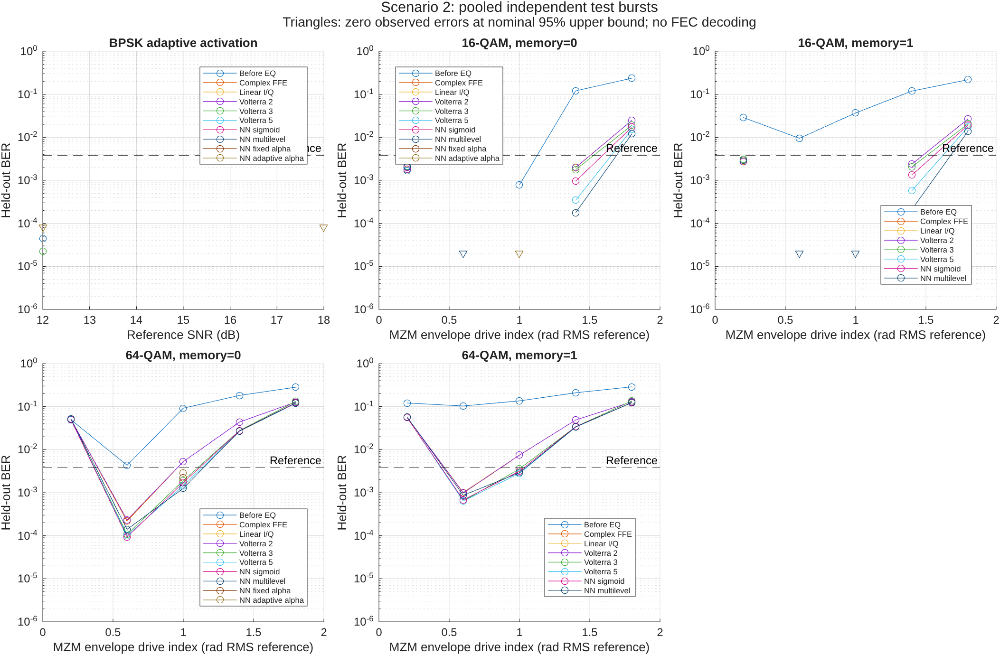
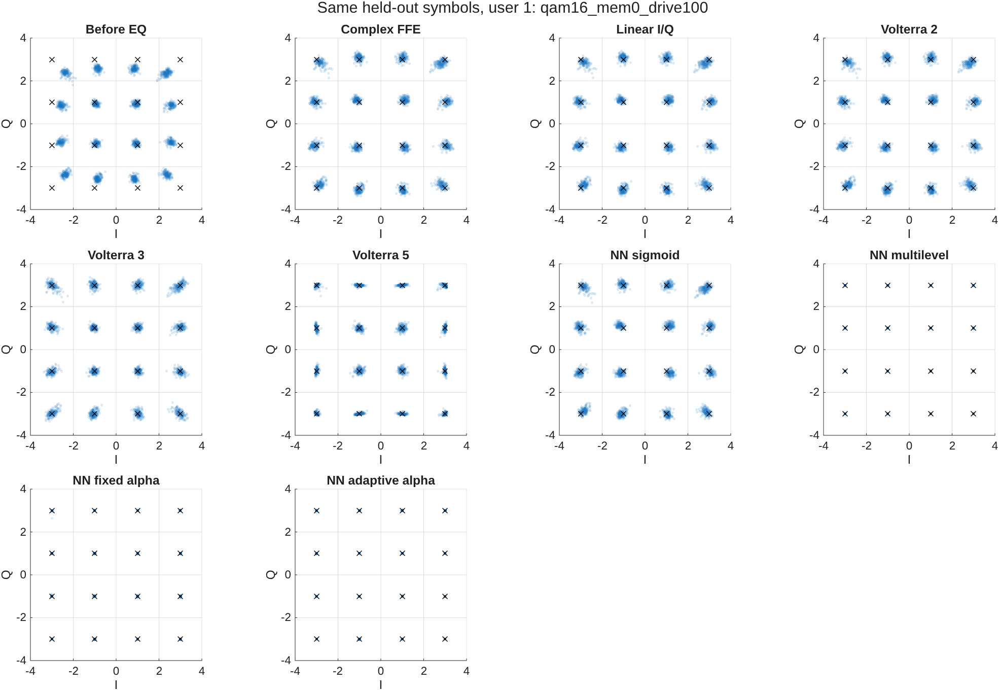
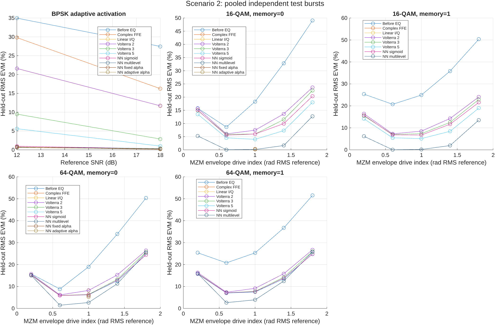
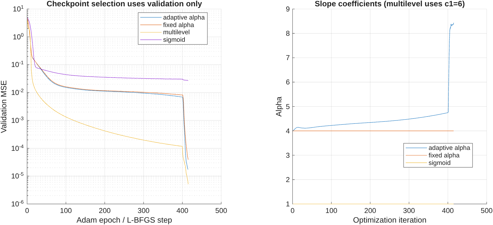

# Scenario 2: validated results

Completed 69 operating-point runs across independent replicate seeds and 576 MATLAB-verified receiver/user metric evaluations.

Representative condition: `qam16_mem0_drive100`.

| Receiver | RMS EVM (%) | Bit errors | Bits tested | BER |
|---|---:|---:|---:|---:|
| Before EQ | 18.307 | 141 | 179988 | 0.00078339 |
| Complex FFE | 7.455 | 0 | 179988 | 0 observed; upper95=2.05e-05 |
| Linear I/Q | 7.457 | 0 | 179988 | 0 observed; upper95=2.05e-05 |
| NN adaptive alpha | 0.174 | 0 | 179988 | 0 observed; upper95=2.05e-05 |
| NN fixed alpha | 0.306 | 0 | 179988 | 0 observed; upper95=2.05e-05 |
| NN multilevel | 0.124 | 0 | 179988 | 0 observed; upper95=2.05e-05 |
| NN sigmoid | 6.004 | 0 | 179988 | 0 observed; upper95=2.05e-05 |
| Volterra 2 | 7.461 | 0 | 179988 | 0 observed; upper95=2.05e-05 |
| Volterra 3 | 5.996 | 0 | 179988 | 0 observed; upper95=2.05e-05 |
| Volterra 5 | 3.988 | 0 | 179988 | 0 observed; upper95=2.05e-05 |

All fits use training data, checkpoint/ridge selection uses validation data, and test targets are used only for evaluation. Zero errors are finite-sample observations. Nominal binomial 95% intervals may be optimistic with correlated errors. The 3.8e-3 line is a literature reference, not an implemented FEC decoder.

Large datasets, checkpoints, editable FIG and vector PDF exports remain in `datasets/scenarios/scenario2/scenario2_validated_study`; source snapshots and hashes are recorded in `validation_record.json`. The recorded Git revision precedes this scenario commit because validation runs before committing.

See [scenario equations and limitations](../../SCENARIOS.md).

[Measured findings and limitations](INTERPRETATION.md).
