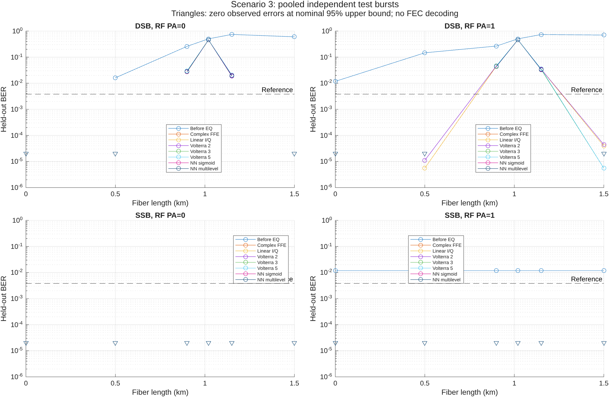
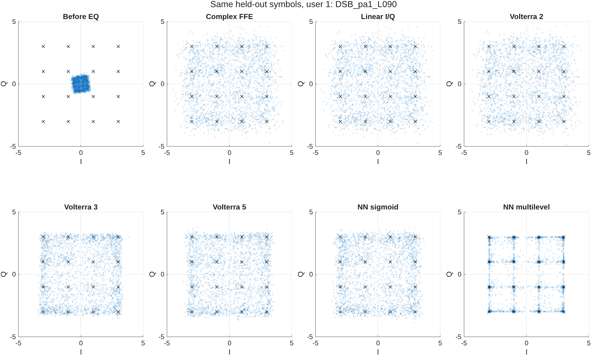
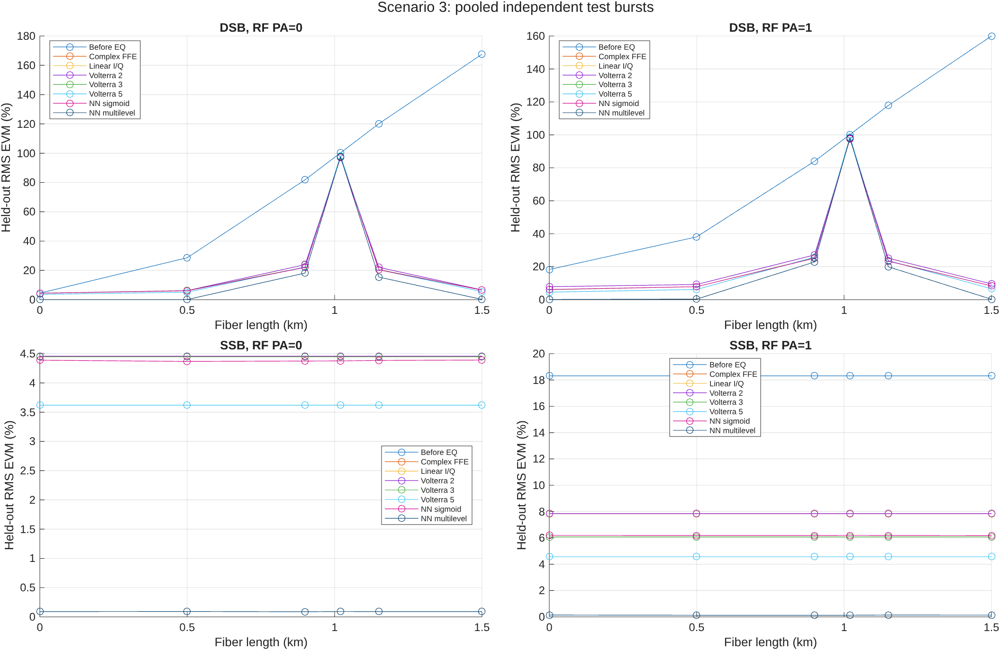
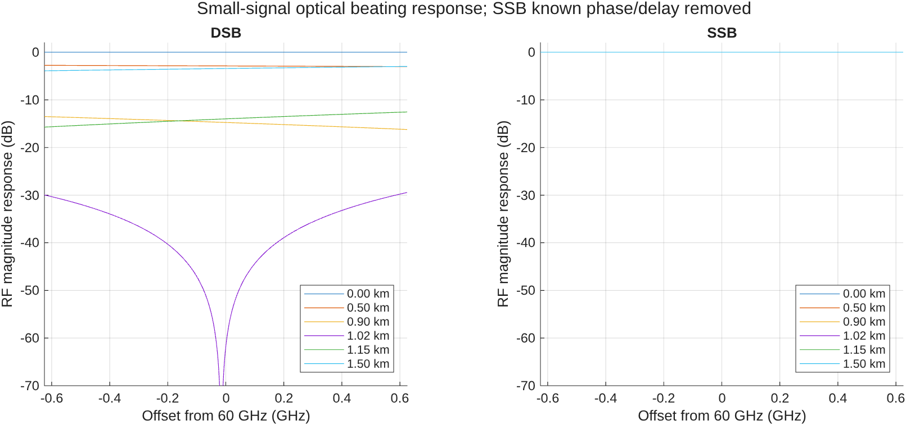
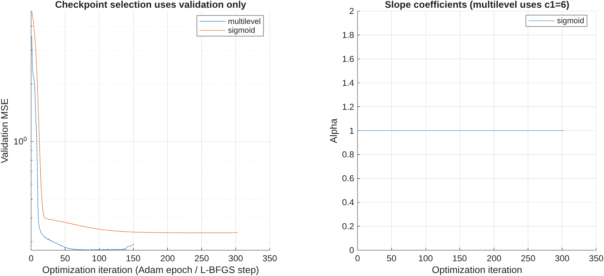

# Scenario 3: validated results

Completed 72 operating-point runs across independent replicate seeds and 576 MATLAB-verified receiver/user metric evaluations.

Representative condition: `DSB_pa1_L090`.

| Receiver | RMS EVM (%) | Bit errors | Bits tested | BER |
|---|---:|---:|---:|---:|
| Before EQ | 84.004 | 47927 | 179976 | 0.2663 |
| Complex FFE | 27.108 | 8223 | 179976 | 0.045689 |
| Linear I/Q | 27.128 | 8294 | 179976 | 0.046084 |
| NN multilevel | 22.887 | 7915 | 179976 | 0.043978 |
| NN sigmoid | 25.175 | 7842 | 179976 | 0.043572 |
| Volterra 2 | 27.167 | 8341 | 179976 | 0.046345 |
| Volterra 3 | 25.351 | 7903 | 179976 | 0.043911 |
| Volterra 5 | 25.795 | 8362 | 179976 | 0.046462 |

All fits use training data, checkpoint/ridge selection uses validation data, and test targets are used only for evaluation. Zero errors are finite-sample observations. Nominal binomial 95% intervals may be optimistic with correlated errors. The 3.8e-3 line is a literature reference, not an implemented FEC decoder.

Large datasets, checkpoints, editable FIG and vector PDF exports remain in `datasets/scenarios/scenario3/scenario3_validated_study`; source snapshots and hashes are recorded in `validation_record.json`. The recorded Git revision precedes this scenario commit because validation runs before committing.

See [scenario equations and limitations](../../SCENARIOS.md).

[Measured findings and limitations](INTERPRETATION.md).
