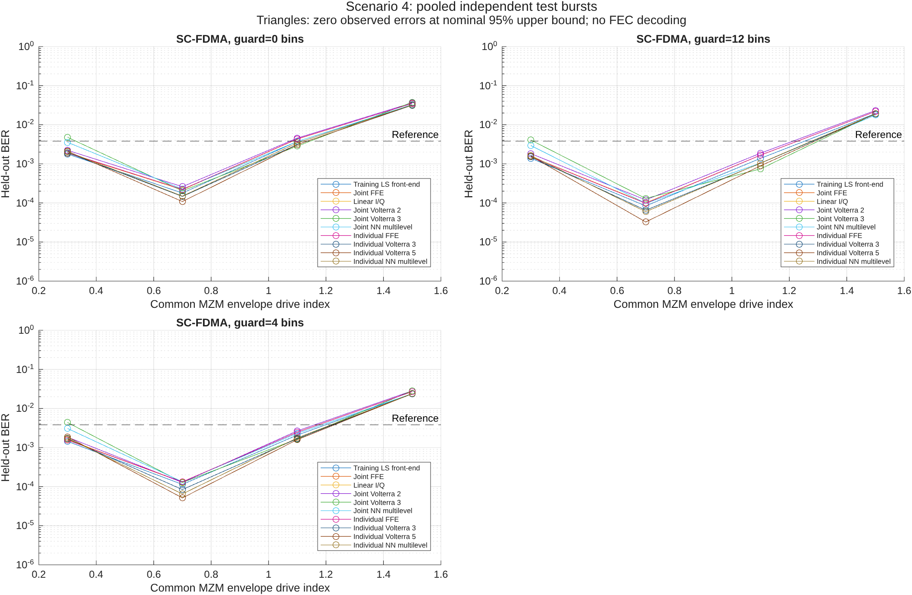
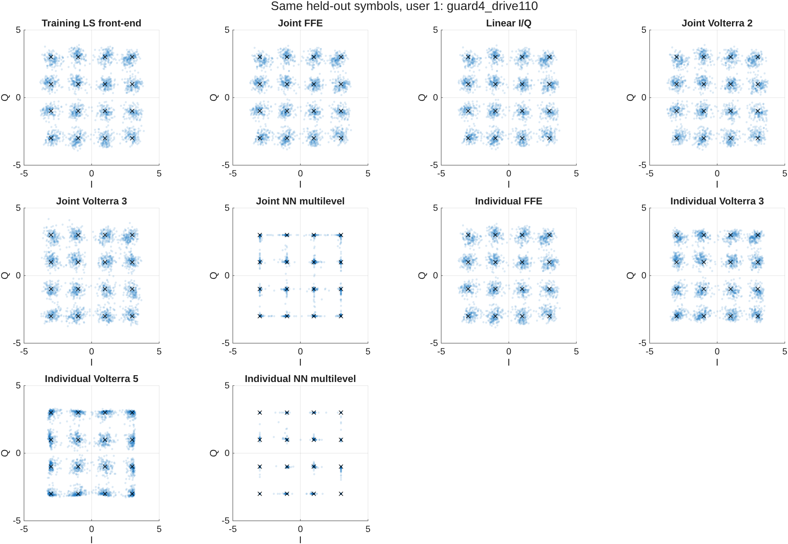
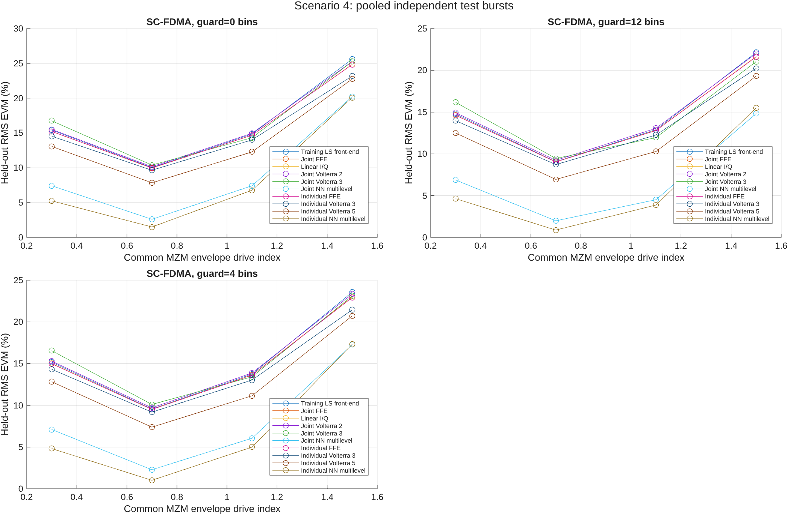
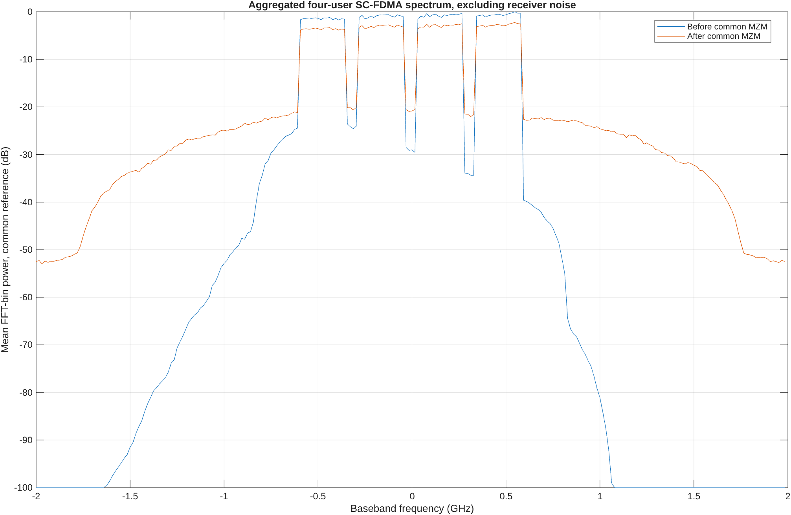
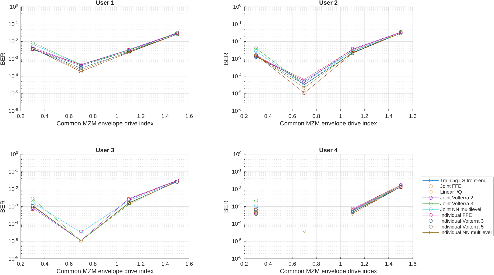
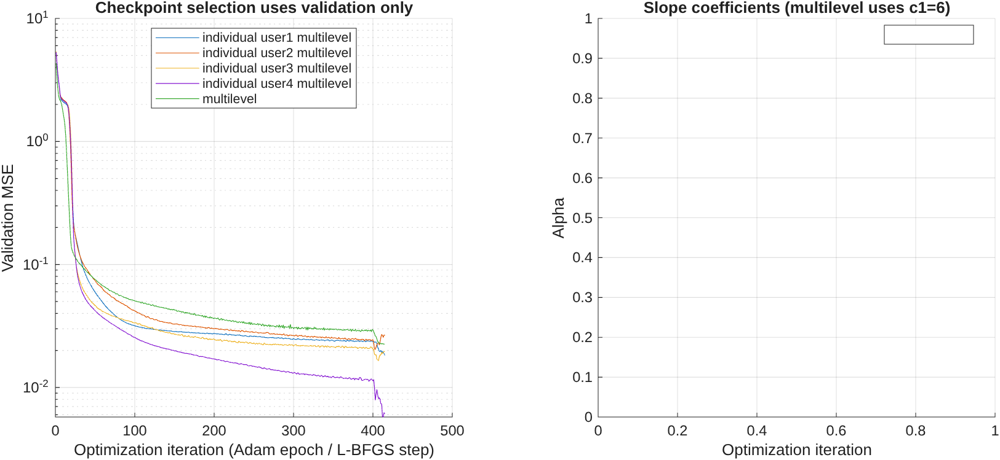

# Scenario 4: validated results

Completed 39 operating-point runs across independent replicate seeds and 1950 MATLAB-verified receiver/user metric evaluations.

Representative condition: `guard4_drive110`.

| Receiver | RMS EVM (%) | Bit errors | Bits tested | BER |
|---|---:|---:|---:|---:|
| Individual FFE | 13.616 | 910 | 368640 | 0.0024685 |
| Individual NN multilevel | 4.994 | 651 | 368640 | 0.001766 |
| Individual Volterra 3 | 13.035 | 623 | 368640 | 0.00169 |
| Individual Volterra 5 | 11.145 | 587 | 368640 | 0.0015923 |
| Joint FFE | 13.629 | 915 | 368640 | 0.0024821 |
| Joint NN multilevel | 6.058 | 850 | 368640 | 0.0023058 |
| Joint Volterra 2 | 13.877 | 985 | 368640 | 0.002672 |
| Joint Volterra 3 | 13.427 | 609 | 368640 | 0.001652 |
| Linear I/Q | 13.647 | 918 | 368640 | 0.0024902 |
| Training LS front-end | 13.750 | 768 | 368640 | 0.0020833 |

All fits use training data, checkpoint/ridge selection uses validation data, and test targets are used only for evaluation. Zero errors are finite-sample observations. Nominal binomial 95% intervals may be optimistic with correlated errors. The 3.8e-3 line is a literature reference, not an implemented FEC decoder.

Large datasets, checkpoints, editable FIG and vector PDF exports remain in `datasets/scenarios/scenario4/scenario4_validated_study`; source snapshots and hashes are recorded in `validation_record.json`. The recorded Git revision precedes this scenario commit because validation runs before committing.

See [scenario equations and limitations](../../SCENARIOS.md).

[Measured findings and limitations](INTERPRETATION.md).
