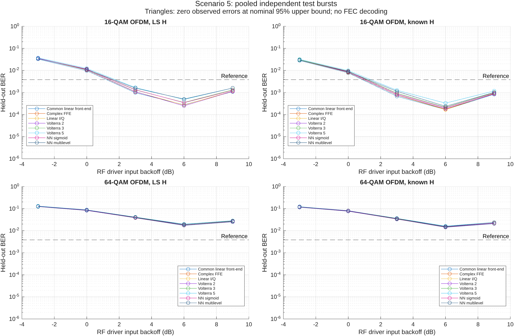
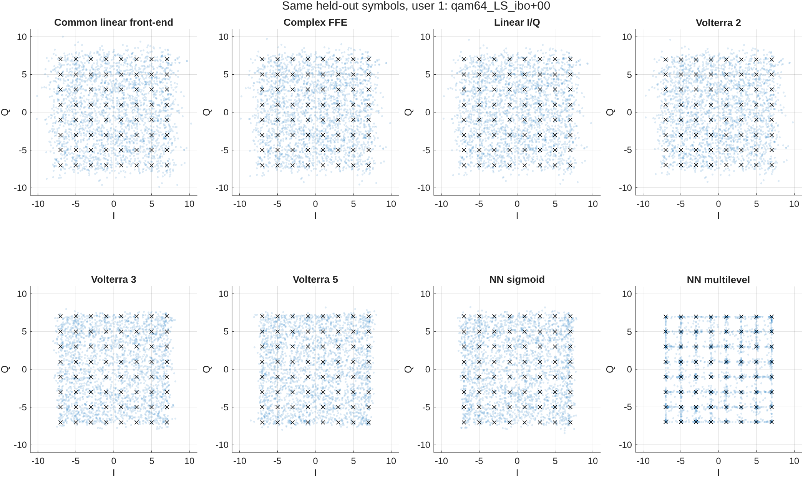
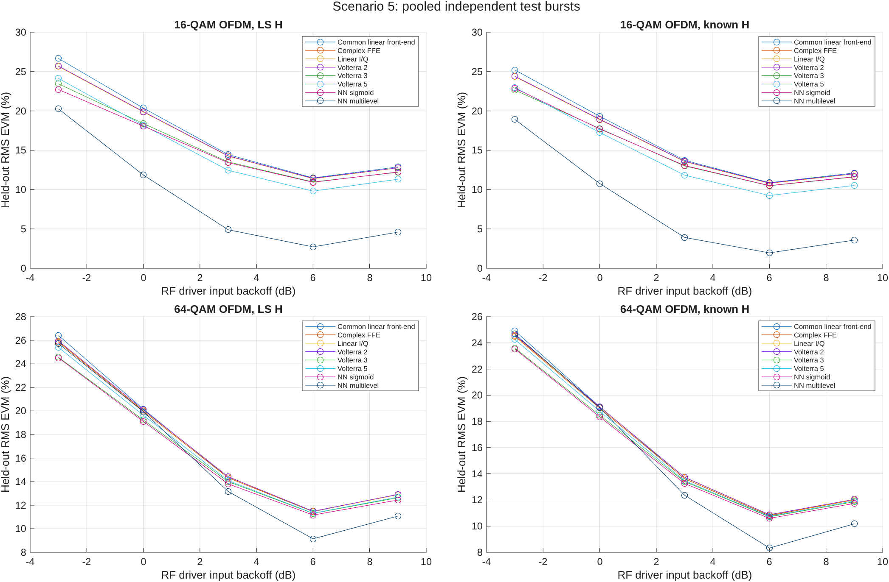
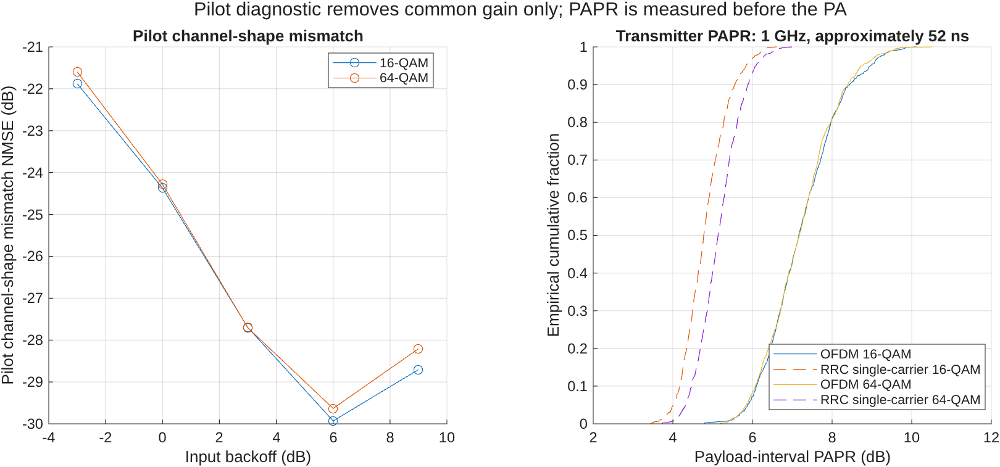
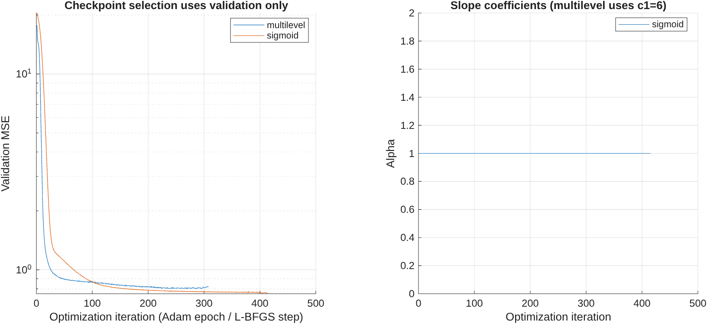

# Scenario 5: validated results

Completed 66 operating-point runs across independent replicate seeds and 528 MATLAB-verified receiver/user metric evaluations.

Representative condition: `qam64_LS_ibo+00`.

| Receiver | RMS EVM (%) | Bit errors | Bits tested | BER |
|---|---:|---:|---:|---:|
| Common linear front-end | 20.157 | 21250 | 259200 | 0.081983 |
| Complex FFE | 19.987 | 22260 | 259200 | 0.08588 |
| Linear I/Q | 20.070 | 22722 | 259200 | 0.087662 |
| NN multilevel | 19.941 | 22237 | 259200 | 0.085791 |
| NN sigmoid | 19.113 | 21648 | 259200 | 0.083519 |
| Volterra 2 | 20.099 | 22737 | 259200 | 0.08772 |
| Volterra 3 | 19.231 | 21962 | 259200 | 0.08473 |
| Volterra 5 | 19.637 | 22675 | 259200 | 0.087481 |

All fits use training data, checkpoint/ridge selection uses validation data, and test targets are used only for evaluation. Zero errors are finite-sample observations. Nominal binomial 95% intervals may be optimistic with correlated errors. The 3.8e-3 line is a literature reference, not an implemented FEC decoder.

Large datasets, checkpoints, editable FIG and vector PDF exports remain in `datasets/scenarios/scenario5/scenario5_validated_study`; source snapshots and hashes are recorded in `validation_record.json`. The recorded Git revision precedes this scenario commit because validation runs before committing.

See [scenario equations and limitations](../../SCENARIOS.md).

[Measured findings and limitations](INTERPRETATION.md).
