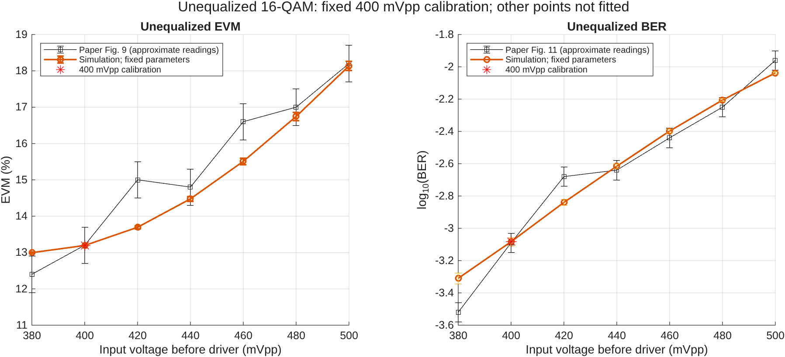

# Unequalized 16-QAM voltage curve

This tests extrapolation from the calibrated 400 mVpp point. Driver gain and aggregate IF-noise PSD remain fixed; no other voltage is fitted. No equalizer or NN is used.

Frozen effective driver gain: 15.597535; IF noise PSD: 4.0599851e-15 normalized units squared/Hz.

| Input mVpp | Paper EVM (%) | Simulation EVM (%) | Paper BER | Simulation BER | Fitted voltage? |
|---:|---:|---:|---:|---:|---|
| 380 | 12.400 | 12.995 | 0.000302 | 0.0004898 | 0 |
| 400 | 13.200 | 13.193 | 0.0008128 | 0.0008255 | 1 |
| 420 | 15.000 | 13.694 | 0.002089 | 0.001446 | 0 |
| 440 | 14.800 | 14.476 | 0.002291 | 0.002424 | 0 |
| 460 | 16.600 | 15.509 | 0.003631 | 0.003999 | 0 |
| 480 | 17.000 | 16.744 | 0.005623 | 0.006224 | 0 |
| 500 | 18.200 | 18.135 | 0.01096 | 0.009164 | 0 |

Outside the calibration voltage, 3/6 EVM points and 3/6 BER points fall within the declared paper read-off allowances. This descriptive count is not an experimental validation test.

The paper points are approximate visual readings of Figures 9 and 11. Read-off allowances are not experimental confidence intervals. EVM simulation bars show seed standard deviation; BER bars show nominal Wilson intervals, assuming independent bits. Temporal dependence limits those intervals.

Each voltage uses the same preselected seeds and payload length as the single-point check. The existing 400 mVpp validation samples are reused exactly. Within a seed, waveform and noise draws are shared across voltages for paired comparisons; voltage points are not independent replicates.

Only a single operating-point gain and noise level were identified. The driver transfer curve and common received-power/noise conditions across paper figures are not established. Agreement at 400 mVpp does not establish agreement elsewhere. Deviations are retained rather than removed by per-point fitting.

PNG plots and vector PDF versions are provided. CSV files preserve per-seed counts, pooled metrics and differences from the paper.
