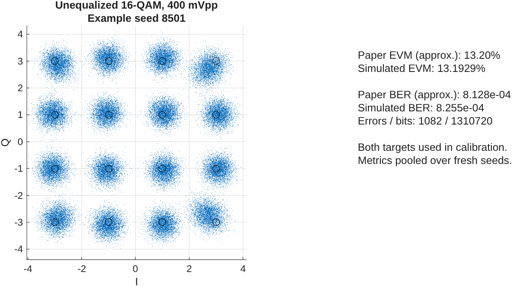

# One unequalized operating point

16-QAM, 400 mVpp before the driver, 0.4 Gbaud, 15 km optical-beating A-RoF link. No equalizer or NN.

| Metric | Approximate paper target | Fresh-seed simulation |
|---|---:|---:|
| Continuous RMS EVM | 13.200% | 13.19292% |
| Gray-bit BER | 0.000812831 | 0.0008255 |

Observed 1082 errors in 1310720 bits. Nominal 95% Wilson interval: [0.000777774, 0.000876153]. Bit dependence and only a few seeds limit this interval's interpretation.

Effective driver gain at this one point: 15.5975; inferred IF noise PSD: 4.05999e-15 normalized detector-output units squared/Hz. Effective gain is constrained to 12.5–25, rather than extrapolating a complete amplifier transfer curve. The paper does not report the actual MZM voltage at 400 mVpp; this is an operating-point calibration, not a measured driver model.

**Both EVM and BER targets were used to fit gain and aggregate noise.** Calibration uses a noiseless trace plus Gaussian decision-cell probabilities; validation injects actual real IF noise into the complete link with independent seeds. This is a calibrated single-point match attempt, not independent experimental reproduction. Figures 9 and 11 do not establish a common received optical power; treating the two targets as one condition is explicit. EVM target read-off allowance is ±0.5 percentage points; BER read-off allowance is ±0.06 log10 units.

The optical/RF response, amplitude-envelope detector and noise-budget assumptions remain approximate. Do not extrapolate this calibrated gain to other drives or claim a calibrated optical-power budget.

